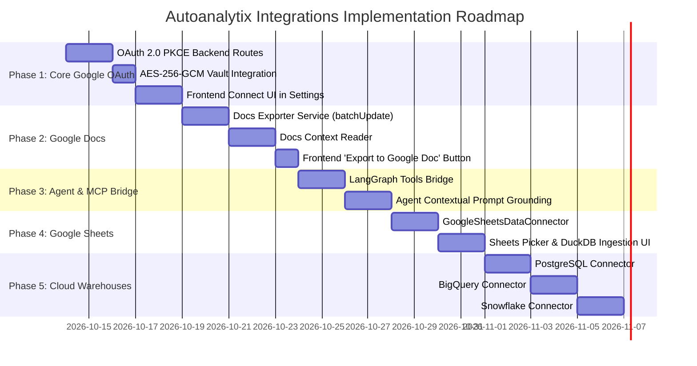

# Autoanalytix Integrations Architecture & Implementation Blueprint

> **Status:** Architecture Proposal & Build Guide  
> **Target Integrations:** Google Workspace (Docs, Sheets, Drive via Hybrid MCP + REST), Cloud Data Warehouses (PostgreSQL, BigQuery, Snowflake)  
> **Auth Standard:** Google OAuth 2.0 (PKCE) + Authenticated AES-256-GCM Token Encryption  

---

## 1. Executive Summary & Goals

Autoanalytix is evolving from an isolated CSV/Excel and local SQLite analytics tool into a connected business intelligence hub. The goal is to support:

1. **Google Docs**: 
   - **Exporting:** One-click & agentic generation of executive reports, statistical summaries, and analysis findings directly into formatted Google Docs.
   - **Context Ingestion:** Enabling the LangGraph AI analytical agent to read company documents (PRDs, KPI guidelines, quarterly goals) to contextualize data questions.
2. **Google Sheets & Google Drive**:
   - Directly importing cloud spreadsheets and Drive-stored files into DuckDB datasets for zero-friction querying and scheduled syncs.
3. **Cloud Data Warehouses & SQL**:
   - Native connectors for **PostgreSQL**, **Google Cloud BigQuery**, and **Snowflake** adhering to the existing `BaseDataConnector` interface.
4. **Hybrid Protocol Architecture**:
   - **Direct REST API + OAuth2:** For deterministic, user-facing UI actions (file pickers, OAuth connections, manual exports).
   - **Model Context Protocol (MCP) Bridge:** For the LangGraph AI agent to dynamically discover and invoke Google Docs and Drive tools as part of its reasoning loop.

---

## 2. High-Level System Architecture

```mermaid
flowchart TD
    subgraph Frontend ["Frontend (React 18 + TypeScript + Vite)"]
        UI_Integ["Settings / Integrations Page\n• Google OAuth Connect\n• Warehouse Credentials"]
        UI_Export["Analytics Workspace & Dashboards\n• 'Export to Google Doc' Button"]
        UI_Picker["Datasets Explorer\n• 'Import Google Sheet' Modal"]
    end

    subgraph Backend_API ["FastAPI Backend Services"]
        OAuthRoute["OAuth Controller\n/api/integrations/google/oauth"]
        TokenVault["Token Vault (AES-256-GCM)\nSecure Token Encryption at Rest"]
        GoogleClient["Google Workspace Service\n• Docs API v1\n• Sheets API v4\n• Drive API v3"]
        WarehouseService["Warehouse Connectors Engine\n(PostgreSQL, BigQuery, Snowflake)"]
    end

    subgraph Analytics_Engine ["Core Engine & Storage"]
        DuckDB["DuckDB Analytical In-Process Engine"]
        Storage["Parquet / Columnar Storage"]
    end

    subgraph AI_Agent ["LangGraph Analytical Agent"]
        AgentCore["Stateful LangGraph Agent\n(Intent & Plan Formulation)"]
        MCPBridge["MCP / Tools Bridge\n• google_docs_search\n• google_docs_read\n• google_docs_create_report\n• google_sheets_extract"]
    end

    subgraph External ["External Platforms"]
        GoogleAPI["Google Workspace Cloud\n(Docs, Sheets, Drive)"]
        CloudDBs["External Cloud DBs\n(PostgreSQL, BigQuery, Snowflake)"]
    end

    %% Frontend Interactions
    UI_Integ -->|Initiates OAuth / Config| OAuthRoute
    UI_Export -->|Trigger Report Export| GoogleClient
    UI_Picker -->|Select Sheet & Ingest| GoogleClient

    %% Auth & Token Flow
    OAuthRoute -->|Store Encrypted Tokens| TokenVault
    TokenVault -->|Decrypt In-Memory| GoogleClient

    %% External Google Comm
    GoogleClient <-->|REST API (HTTPS)| GoogleAPI
    GoogleClient -->|Stream Rows to DuckDB| DuckDB
    DuckDB --> Storage

    %% Warehouse Flow
    UI_Integ --> WarehouseService
    WarehouseService <-->|SQL Queries| CloudDBs
    WarehouseService -->|Extract Batches| DuckDB

    %% Agent Flow
    AgentCore <-->|Dynamic Tool Calling| MCPBridge
    MCPBridge <-->|Read / Write via Auth Context| GoogleClient
    AgentCore <-->|Execute Validated SQL| DuckDB
```

---

## 3. Why the Hybrid Pattern (MCP + Direct REST)?

### The Problem with "Pure MCP" in Multi-Tenant Web Apps
Model Context Protocol (MCP) is optimized for an AI runtime communicating with tool servers over JSON-RPC (STDIO or SSE). However, in a multi-tenant web application:
- Standard users interact with browser buttons (e.g. clicking **"Export to Google Doc"** or **"Import Sheet"**). Routing a simple button click through an LLM prompt and an MCP tool call is slow, expensive, and non-deterministic.
- MCP servers typically run as standalone daemons without built-in multi-tenant user session isolation unless wrapped in a custom SSE relay that passes per-request OAuth credentials.

### The Solution: Dual-Layered Implementation
1. **The Shared Service Layer (`GoogleWorkspaceService`)**:
   - A robust Python service in FastAPI that knows how to authenticate using workspace-level encrypted OAuth tokens, talk to Google APIs, format documents, and extract sheets.
2. **Layer A — REST Endpoints (for the Frontend UI)**:
   - Deterministic HTTP endpoints for instantaneous UI actions:
     - `POST /api/integrations/google/export-doc`
     - `POST /api/integrations/google/import-sheet`
3. **Layer B — MCP / LangGraph Tool Bridge (for the AI Agent)**:
   - Tool functions conforming to the MCP / LangChain standard, wrapped around `GoogleWorkspaceService`:
     - `google_docs_search(query: str)`: Finds relevant strategy and metric documents.
     - `google_docs_read(doc_id: str)`: Returns document markdown to supply context to the LLM.
     - `google_docs_create_report(title: str, content_markdown: str)`: Generates an executive briefing when the user asks: *"Write a Google Doc report summarizing these revenue anomalies."*

---

## 4. Architectural Specifications by Component

### Component A: Google OAuth 2.0 & Token Vault

#### 1. OAuth Scopes Required
To maintain least privilege while supporting Docs, Sheets, and Drive:
- `https://www.googleapis.com/auth/documents` (Create and update Google Docs)
- `https://www.googleapis.com/auth/spreadsheets.readonly` (Read tabular sheet data)
- `https://www.googleapis.com/auth/drive.file` (View and manage files created or opened by the app)
- `https://www.googleapis.com/auth/userinfo.email` (Identity verification)

#### 2. Backend Flow (`backend/app/api/integrations_google.py`)
- **`GET /api/integrations/google/oauth/url`**: Generates Google OAuth consent URL with `access_type=offline`, `prompt=consent`, and a cryptographically signed state token carrying `workspace_id` and `user_id`.
- **`GET /api/integrations/google/oauth/callback`**:
  1. Validates `state` parameter to prevent CSRF.
  2. Exchanges authorization code for `access_token`, `refresh_token`, and token expiry.
  3. Encrypts tokens using the platform's AES-256-GCM encryption service (`app.core.security.encrypt_data`).
  4. Stores the connection record in the database under `workspace_integrations`.
- **`DELETE /api/integrations/google/disconnect`**: Revokes the Google token and cleans up stored credentials.

#### 3. Database Schema (`WorkspaceIntegration`)
```python
class WorkspaceIntegration(Base):
    __tablename__ = "workspace_integrations"

    id: str                  # UUID
    workspace_id: str        # Foreign key
    provider: str            # "google_workspace"
    account_email: str       # user@company.com
    encrypted_credentials: str  # AES-256-GCM cipher payload (contains refresh_token, access_token, expiry)
    status: str              # "connected", "expired", "revoked"
    created_at: datetime
    updated_at: datetime
```

---

### Component B: Google Docs Integration

#### 1. Document Exporter Service (`app/integrations/google/docs_exporter.py`)
Responsible for converting analytical results, AI insights, and chart summaries into structured Google Docs.
- **Document Structure**:
  - **Header / Title**: Title of analysis, timestamp, dataset reference, and author.
  - **Executive Summary**: Key analytical findings synthesized by the AI.
  - **Statistical Metrics**: Key KPIs rendered as a styled summary table.
  - **Structured Analysis**: Sections with headers (H1, H2, H3), body text, and bullet points.
  - **SQL Query & Provenance**: Grounded DuckDB SQL queries formatted in monospace blocks.
- **Implementation via Google Docs API `batchUpdate`**:
  - Uses `InsertTextRequest`, `UpdateParagraphStyleRequest`, `InsertTableRequest`, and `InsertTableCellTextRequest` to build a clean corporate document.

#### 2. Document Context Reader (`app/integrations/google/docs_reader.py`)
- Reads Google Doc content via `docs.get(documentId=doc_id)`.
- Parses document elements (paragraphs, tables, lists) into clean Markdown.
- Passes the extracted Markdown into the LangGraph state context as domain knowledge.

---

### Component C: Google Sheets Data Connector

Extends Autoanalytix's `BaseDataConnector`:

```python
class GoogleSheetsDataConnector(BaseDataConnector):
    connector_type = "google_sheets"
    display_name = "Google Sheets"

    def test_connection(self, config: Dict[str, Any]) -> Dict[str, Any]:
        """Verifies sheet exists and is accessible via stored OAuth token."""
        ...

    def list_tables(self, config: Dict[str, Any]) -> List[str]:
        """Lists sheet tab names (e.g. ['Q1 Sales', 'Customers', 'Targets'])."""
        ...

    def get_table_schema(self, config: Dict[str, Any], table_name: str) -> List[Dict[str, str]]:
        """Inspects first row header and infers data types."""
        ...

    def extract_data(self, config: Dict[str, Any], table_name: str, limit: int = 50000) -> List[Dict[str, Any]]:
        """Extracts tabular rows, streams them into DuckDB as a managed dataset."""
        ...
```

---

### Component D: Model Context Protocol (MCP) & LangGraph Agent Bridge

#### 1. Agent Tool Definitions (`app/ai/tools/google_workspace_tools.py`)
The LangGraph agent is given typed tools to call during reasoning:

```python
@tool
def search_company_docs(query: str, workspace_id: str) -> str:
    """Searches the company Google Drive / Google Docs for relevant strategy,
    definitions, KPI descriptions, or PRDs."""
    ...

@tool
def read_doc_context(doc_id: str, workspace_id: str) -> str:
    """Reads the full text of a Google Doc to provide business context for data analysis."""
    ...

@tool
def export_analysis_to_google_doc(title: str, summary_markdown: str, workspace_id: str) -> str:
    """Creates a new Google Doc containing the analytical findings and returns the shareable URL."""
    ...
```

#### 2. LangGraph State Flow Integration
When a user asks:
> *"Can you analyze why churn spiked in March based on our retention goals in our Q1 Strategy Doc and write up a report in Google Docs?"*

1. **Planner Node**: Identifies need for both tabular SQL analysis and document context.
2. **Context Retrieval**: Invokes `search_company_docs("Q1 Strategy")` &rarr; `read_doc_context(doc_id)`.
3. **SQL Formulation Node**: Formulates SQL against DuckDB taking the strategy document's churn formula into account.
4. **Execution & AST Security**: Validates single-statement `SELECT` with `sqlglot` and runs in DuckDB.
5. **Synthesis Node**: Synthesizes tabular statistics with the document's objectives.
6. **Action Node**: Invokes `export_analysis_to_google_doc(...)` and responds to the user with the insights and the Google Doc URL.

---

### Component E: Cloud Warehouses Connectors (`BaseDataConnector` Extensions)

Expand `backend/app/data_sources/` with production warehouse connectors:

#### 1. PostgreSQL Connector (`postgres_connector.py`)
- **Library**: `psycopg2-binary` or `asyncpg` with connection pooling.
- **Config**: Host, Port, Database, User, Password (encrypted with AES-GCM), SSL Mode.
- **Features**: List schemas and tables, inspect `information_schema.columns`, extract data with safe pagination.

#### 2. Google Cloud BigQuery Connector (`bigquery_connector.py`)
- **Library**: `google-cloud-bigquery`
- **Config**: Project ID, Dataset ID, Service Account JSON key (or shared Google OAuth token).
- **Features**: List tables, fetch BigQuery schema datatypes, extract query results directly into DuckDB/Parquet.

#### 3. Snowflake Connector (`snowflake_connector.py`)
- **Library**: `snowflake-connector-python`
- **Config**: Account identifier, Warehouse, Database, Schema, Username, Password / Key pair.
- **Features**: List tables, column schema introspection, chunked query result streaming into DuckDB.

---

### Component F: Frontend UX & Pages

#### 1. New Page: Integrations & Connected Apps (`/settings/integrations`)
- **Google Workspace Card**:
  - Status indicator: `Connected as user@company.com` or `Not Connected`.
  - Action buttons: `Connect Google Account`, `Reconnect`, `Disconnect`.
  - Feature badges: `Google Docs Reporting`, `Google Sheets Importer`, `Drive File Search`.
- **Cloud Warehouses Section**:
  - Visual cards for `PostgreSQL`, `Google BigQuery`, `Snowflake`, and `SQLite`.
  - Connection modals with field validation and immediate **"Test Connection"** ping.

#### 2. Export Button in Analytics & Dashboards
- In `AnalyticsWorkspace.tsx` and `DashboardDetail.tsx`:
  - **"Export to Google Doc"** action in the header dropdown.
  - Displays a brief modal to name the document and select included sections.
  - Generates the doc and presents an instant **"Open in Google Docs"** external link.

#### 3. Sheets Import in Datasets Explorer (`DatasetsPage.tsx`)
- An additional tab in the Upload Modal: **"Import from Google Sheets"**.
- Allows entering a Google Sheet URL or browsing accessible sheets from Google Drive.
- Ingests selected tab into DuckDB with automatic schema inference.

---

## 5. Security & Multi-Tenancy Architecture

| Area | Security Standard & Implementation |
|---|---|
| **Token Encryption** | All OAuth refresh/access tokens and database passwords are encrypted at rest using **AES-256-GCM** with an independent application encryption key (`AES_SECRET_KEY`). |
| **Zero Memory Leakage** | Tokens are never returned to frontend HTTP responses, never serialized into logs, and never committed to source control. |
| **AST Security Validation** | All AI-generated SQL continues to pass through `sqlglot` AST checking before hitting DuckDB or remote databases. |
| **OAuth Scope Minimization** | Request only granular scopes (`drive.file`, `spreadsheets.readonly`, `documents`) rather than full Google Drive root access. |
| **Workspace Isolation** | All integration records and connectors are scoped strictly by `workspace_id` and verified via JWT claims. |

---

## 6. Phased Implementation Roadmap



### Next Steps to Begin Implementation:
1. Initialize the `google-auth`, `google-api-python-client`, and `google-auth-oauthlib` dependencies in `backend/requirements.txt`.
2. Implement `backend/app/api/integrations_google.py` with the OAuth URL generation and callback flow.
3. Build the frontend **Connected Apps** settings tab in `frontend/src/pages/DataSourcesSettings.tsx` or a dedicated `IntegrationsSettings.tsx`.
