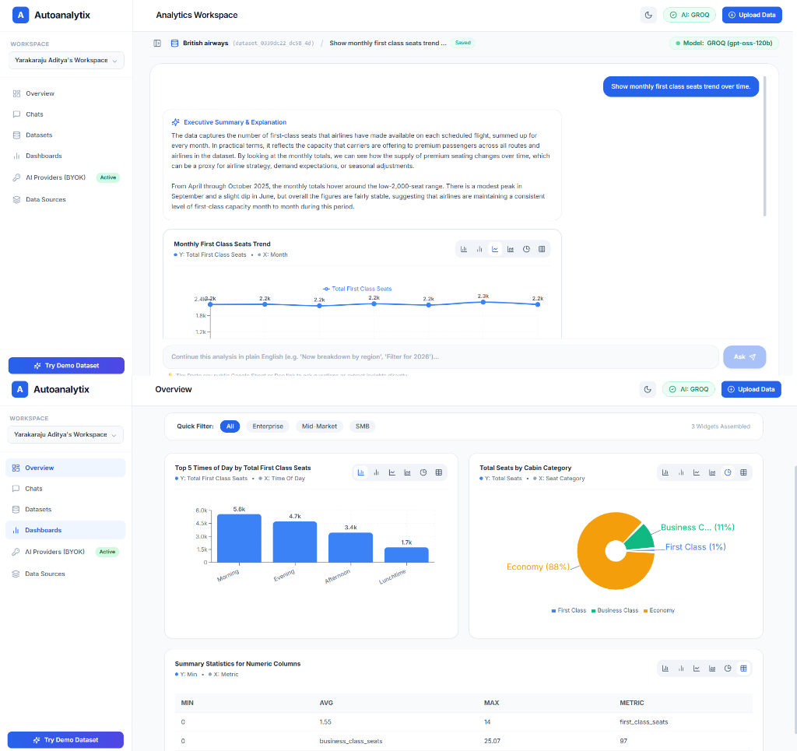
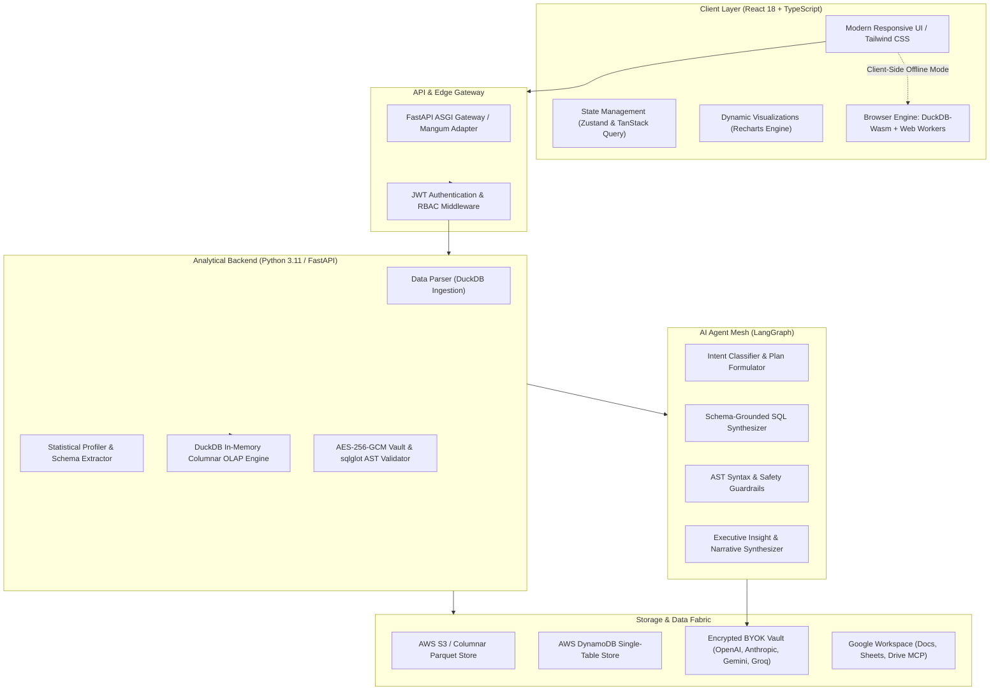
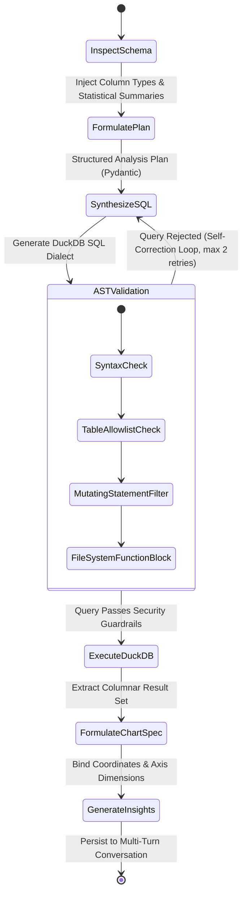
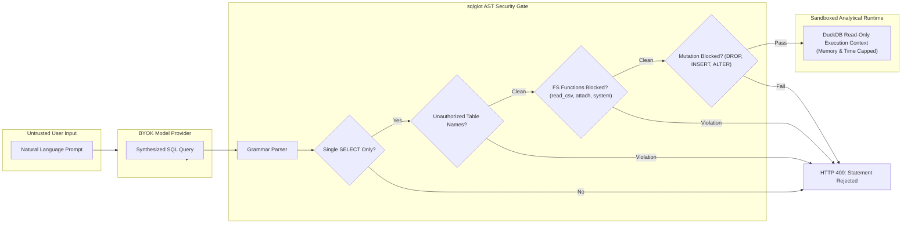

<div align="center">

  

  # Autoanalytix

  ### AI-Native Autonomous Business Intelligence & Conversational Analytics Engine

  <p align="center">
    Transform raw operational datasets into verified SQL, real-time interactive dashboards, and actionable executive insights through autonomous agentic intelligence.
  </p>

  <p align="center">
    <a href="#quick-start"></a>
    <a href="#core-capabilities"></a>
    <a href="https://github.com/aditya0589/Autoanalytix/stargazers"></a>
  </p>

  <p align="center">
    
    
    
    
    
    
    
    
    
  </p>

  <br />

  

</div>

<br />

---

## Highlights at a Glance

* **Conversational Natural Language OLAP**: Ask multi-turn business questions in plain English. The agent formulates schema-grounded SQL, executes sub-second analytical queries, and synthesizes executive insights.
* **Columnar In-Process DuckDB Engine**: Zero-copy vector processing with DuckDB for instant calculations across millions of rows (CSV, Parquet, Excel, Google Sheets).
* **Stateful LangGraph Reasoning Graph**: Deterministic multi-step reasoning DAG featuring autonomous reflection, self-healing SQL syntax error correction, and automated schema grounding.
* **Zero-Hallucination AST Security Gate**: Every synthesized query passes through a strict `sqlglot` Abstract Syntax Tree (AST) guardrail — strictly enforcing read-only `SELECT` invariants and blocking DML/DDL or unauthorized system calls.
* **Zero-Trust BYOK Vault**: Users bring their own keys (Groq, Gemini, Claude, OpenAI) encrypted at rest with authenticated **AES-256-GCM**. Keys are never logged, never returned to browser bundles, and decrypted strictly in volatile memory.
* **Hybrid Dual-Execution Architecture**: Choose between Serverless Cloud (AWS Lambda + S3 + DynamoDB) or **100% Client-Side In-Browser DuckDB-Wasm** for zero-backend, air-gapped data privacy.
* **Google Workspace & MCP Integration**: Native bidirectional tools for Google Sheets data ingestion, Google Drive contextual search, and one-click executive report export directly to formatted Google Docs.

---

## System Architecture

Autoanalytix uses an asynchronous, decoupled micro-architecture designed for sub-second query latency, strict multi-tenant isolation, and cryptographic zero-trust credential security.



---

## Quick Start

### Option 1: Docker Compose (Recommended)

Run the full platform (FastAPI Backend, React Frontend, and in-memory DuckDB) with a single command:

```bash
# 1. Clone the repository
git clone https://github.com/aditya0589/Autoanalytix.git
cd Autoanalytix

# 2. Copy the example environment file
cp .env.example .env

# 3. Launch via Docker Compose
docker-compose up --build
```

Access the application in your browser:
* **Frontend UI**: [http://localhost:5173](http://localhost:5173)
* **API Documentation**: [http://localhost:8000/docs](http://localhost:8000/docs)
* **Health Check**: [http://localhost:8000/health](http://localhost:8000/health)

---

### Option 2: Local Development Setup

#### Backend Setup (Python 3.11)
```bash
cd backend
python -m venv venv

# Windows
.\venv\Scripts\activate
# Linux / macOS
source venv/bin/activate

pip install -r requirements.txt
uvicorn app.main:app --reload --port 8000
```

#### Frontend Setup (Node 18+)
```bash
cd frontend
npm install
npm run dev
```

---

## Core Capabilities

### 1. Conversational Natural Language Analytics
Ask multi-turn analytical questions without writing code. The underlying agent understands business intents, detects dimensional groupings, computes window aggregates, and automatically handles temporal trends, filtering, and cross-column comparisons.

### 2. Automated Deep Statistical Profiling
Upon ingestion, datasets are parsed into columnar Parquet format and profiled automatically:
- **Distribution Metrics**: Cardinality, unique count, null ratios, and data types.
- **Statistical Aggregates**: Quantiles, standard deviation, min/max bounds, and skewness for numerical features.
- **Smart Query Recommendations**: Generates schema-tailored business hypotheses and suggested starter questions.

### 3. Interactive Multi-Modal Dashboard Builder
- **Instant Chart Switcher**: Dynamically flip between Bar, Horizontal Bar, Line, Area, Pie, KPI, and Tabular views without re-running underlying analytical queries.
- **Autonomous AI Generation**: Generate complete executive dashboards covering growth, segmentation, margins, and operational performance from a single prompt.
- **Global Analytical Filtering**: Apply cross-card slicing by dimension, customer cohort, product line, or date interval.

### 4. Zero-Trust Bring-Your-Own-Key (BYOK) Inference
- Platform users supply their own API keys for **Google Gemini, OpenAI, Anthropic Claude, Groq, or OpenRouter**.
- Encrypted using **authenticated AES-256-GCM** with isolated salt and nonce generation.
- Decryption occurs strictly in-memory during inference execution; keys are never logged, never returned to client bundles, and never exposed to other workspace members.

### 5. Google Workspace Integration (MCP & REST)
- **Direct Sheet Ingestion**: Ingest live Google Sheets directly into columnar DuckDB without requiring third-party ETL connectors.
- **Executive Report Generation**: Export grounded analytical briefs, verification queries, data tables, and AI insights directly to formatted Google Docs.
- **Model Context Protocol (MCP)**: AI agents leverage native tools to search Google Drive documents to ground numerical trends in operational context.

### 6. Cryptographically Unguessable Public Sharing
- Share interactive dashboards with external stakeholders via 256-bit entropy tokens.
- Public views operate in read-only sandbox mode: internal database structures, workspace settings, and AI provider configurations remain strictly redacted.

---

## LangGraph State Machine Workflow

Autoanalytix models analytical query answering not as a single naive prompt, but as a deterministic, stateful directed acyclic graph (DAG) orchestrated by **LangGraph**:



### Self-Correction & Reflection Loop
If an LLM synthesizes SQL that violates schema boundaries, uses non-existent column identifiers, or fails AST policy checks, the execution error is captured and reflected back into the agent state. The agent autonomously self-corrects without exposing raw database errors to the user.

---

## Security & Query Sandboxing

Because Autoanalytix executes dynamically synthesized SQL against analytical storage engines, multi-layer defense-in-depth is enforced before any query touches the engine:



### Key Guardrails:
1. **Single-Statement Isolation**: Only single-statement queries are evaluated; stacked queries (`;`) are strictly rejected.
2. **Read-Only Invariant**: The query AST is verified to contain exclusively `SELECT` expressions. All Data Manipulation (DML) and Data Definition (DDL) operations (`INSERT`, `UPDATE`, `DELETE`, `DROP`, `ALTER`, `CREATE`, `REPLACE`) throw terminal security exceptions.
3. **Storage Boundary Enforcement**: External filesystem routines (`read_parquet`, `scan_parquet`, `read_csv`, `glob`, `system`, or `ATTACH`) are barred. Queries can only reference pre-registered, session-isolated virtual table identifiers.
4. **Hardware Resource Limits**: Queries execute within rigid resource bounds (2GB memory ceiling, 30-second query timeout, and a 1,000-row preview limit) to prevent denial-of-service via Cartesian joins.

---

## Analytical Feature Matrix

| Capability | Autoanalytix | Legacy BI (Tableau / PowerBI) | Generic Chatbots (ChatGPT) |
| :--- | :---: | :---: | :---: |
| **Query Engine** | In-Process DuckDB Columnar | Heavy Warehouse ETL | None (Hallucinates numbers) |
| **Query Security** | Strict `sqlglot` AST Defense Gate | Manual Permissions | None (Unsanitized) |
| **Inference Cost** | $0 Base (Zero Markup BYOK) | High Seat Licensing | Recurring Subscription |
| **Data Privacy** | Hybrid (Serverless or WASM) | Cloud Lock-in | Transmits Data to Third Parties |
| **Self-Correction** | LangGraph Self-Healing Agent | Static Queries | Context Drifts |
| **Export Formats** | Google Docs, CSV, JSON | PDF, CSV | Raw Markdown |

---

## Technology Stack

```
Frontend:            React 18  •  TypeScript  •  Vite  •  Tailwind CSS  •  Recharts  •  Zustand
Analytical Engine:   DuckDB Columnar OLAP  •  DuckDB-Wasm  •  Apache Arrow  •  SheetJS
AI & Orchestration:  LangGraph  •  LangChain Core  •  Groq  •  Google Gemini  •  Anthropic  •  OpenAI
Security:            sqlglot AST Parser  •  cryptography (AES-256-GCM)  •  PyJWT  •  bcrypt
Backend & Cloud:     FastAPI (ASGI)  •  Pydantic v2  •  AWS Lambda (Containerized)  •  DynamoDB  •  S3
```

---

## Repository Structure

```text
Autoanalytix/
├── backend/                       # Python FastAPI Backend & Agent Core
│   ├── app/
│   │   ├── ai/                    # LangGraph agents, state definitions, LLM adapters
│   │   ├── analytics/             # DuckDB query executor, sqlglot AST validator, profiler
│   │   ├── api/                   # REST routing (auth, datasets, analytics, Google Workspace)
│   │   ├── core/                  # AES-GCM credential vault, DynamoDB & S3 clients, config
│   │   ├── ingestion/             # Multi-format tabular data parsers
│   │   ├── integrations/          # Google Docs/Sheets/Drive REST & MCP integration services
│   │   └── main.py                # ASGI application root & Lambda handler
│   ├── Dockerfile                 # Standard production container
│   ├── Dockerfile.lambda          # AWS Lambda container image specification
│   └── requirements.txt           # Python dependency tree
│
├── frontend/                      # React 18 + TypeScript Client Application
│   ├── src/
│   │   ├── components/            # ChartRenderer, Layout, Ingestion Modals
│   │   ├── pages/                 # AnalyticsWorkspace, DashboardEditor, AIProvidersSettings
│   │   ├── services/              # API Client, DuckDB-Wasm engine, Browser AI runners
│   │   └── stores/                # Zustand application stores
│   ├── package.json               # Node dependency manifest
│   └── vite.config.ts             # Vite build orchestration
│
├── docs/                          # Architectural documentation & media assets
│   └── images/                    # Platform banner & UI previews
├── scripts/                       # Cloud deployment automation & data migration utilities
└── docker-compose.yml             # Single-command local container orchestration
```

---

## Contributing & Community

Contributions are welcomed. Please feel free to submit a Pull Request or open an Issue for bug reports and feature requests.

1. Fork the Project
2. Create your Feature Branch (`git checkout -b feature/AmazingFeature`)
3. Commit your Changes (`git commit -m 'feat: add some AmazingFeature'`)
4. Push to the Branch (`git push origin feature/AmazingFeature`)
5. Open a Pull Request

---

## License

Distributed under the **MIT License**. See [`LICENSE`](LICENSE) for more information.