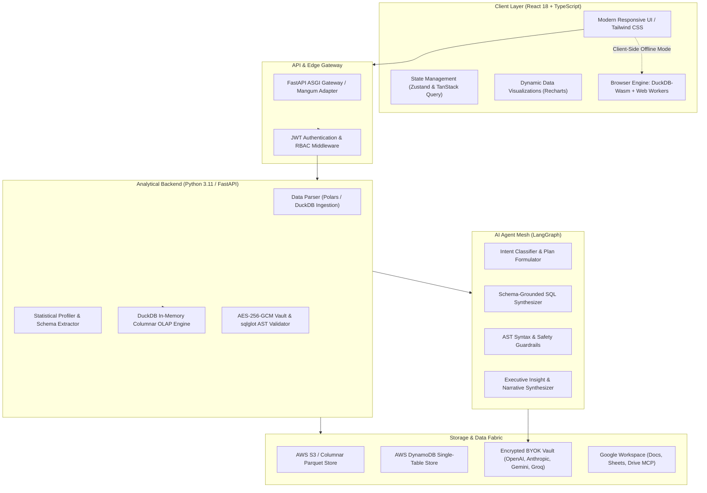
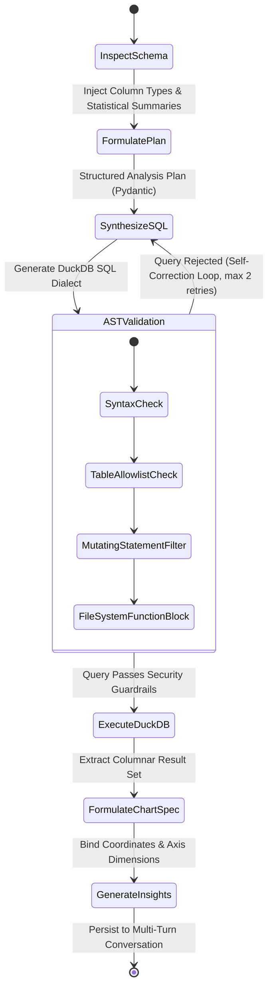
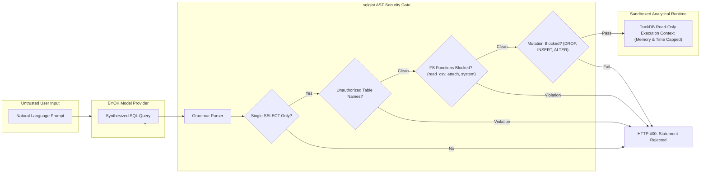

# Autoanalytix

<p align="center">
  
</p>

<h3 align="center">AI-Native Autonomous Business Intelligence & Analytical Engine</h3>

<p align="center">
  Transform raw operational datasets into verified SQL, real-time interactive dashboards, and actionable executive insights using conversational intelligence.
</p>

<p align="center">
  <a href="#core-capabilities"></a>
  <a href="#analytical-engine"></a>
  <a href="#ai-agent-orchestration"></a>
  <a href="#security--sandboxing"></a>
  <a href="#technology-stack"></a>
  
</p>

---

## Overview

**Autoanalytix** is an open-source, AI-native business intelligence platform engineered to eliminate the bottleneck between raw operational data and business decision-making. 

Traditional BI tools demand deep SQL expertise, cumbersome ETL pipelines, and ongoing semantic modeling. Autoanalytix introduces a **declarative, conversation-driven analytics workflow**: users upload raw files (CSV, Parquet, Excel) or connect cloud spreadsheets, and ask complex multi-dimensional questions in plain English. 

Under the hood, Autoanalytix combines a **sandboxed columnar OLAP engine (DuckDB)**, a **stateful multi-step agent graph (LangGraph)**, **abstract syntax tree (AST) query validation**, and a **hybrid dual-execution model** (AWS Serverless Cloud or 100% Client-Side Browser DuckDB-Wasm).

---

## System Architecture

Autoanalytix is built on an asynchronous, decoupled micro-architecture designed for sub-second query latency, strict tenant data isolation, and cryptographic zero-trust credential storage.



---

## Core Product Capabilities

### 1. Conversational Natural Language Analytics
Ask multi-turn analytical questions without writing code. The underlying agent understands business intents, detects dimensional groupings, computes window aggregates, and automatically handles temporal trends, filtering, and cross-column comparisons.

### 2. Automated Deep Statistical Profiling
Upon ingestion, datasets are parsed into columnar Parquet format and profiled automatically:
- **Distribution Metrics**: Cardinality, unique count, null ratios, and data types.
- **Statistical Aggregates**: Quantiles, standard deviation, min/max bounds, and skewness for numerical features.
- **Smart Query Recommendations**: Generates schema-tailored business hypotheses and suggested starter questions.

### 3. Interactive Multi-Modal Dashboard Builder
- **Instant Chart Switcher**: Dynamically flip between Bar, Horizontal Bar, Line, Area, Pie, KPI, and Tabular views without re-running underlying analytical queries.
- **Autonomous AI Generation**: Generate complete executive dashboards covering growth, segmentation, margins, and operational performance from a single prompt.
- **Global Analytical Filtering**: Apply cross-card slicing by dimension, customer cohort, product line, or date interval.

### 4. Zero-Trust Bring-Your-Own-Key (BYOK) Inference
- Platform users supply their own API keys for **Google Gemini, OpenAI, Anthropic Claude, Groq, or OpenRouter**.
- Encrypted using **authenticated AES-256-GCM** with isolated salt and nonce generation.
- Decryption occurs strictly in-memory during inference execution; keys are never logged, never returned to client bundles, and never exposed to other workspace members.

### 5. Google Workspace Integration (MCP & REST)
- **Direct Sheet Ingestion**: Ingest live Google Sheets directly into columnar DuckDB without requiring third-party ETL connectors.
- **Executive Report Generation**: Export grounded analytical briefs, verification queries, data tables, and AI insights directly to formatted Google Docs.
- **Model Context Protocol (MCP)**: AI agents leverage native tools to search Google Drive documents to ground numerical trends in operational context.

### 6. Cryptographically Unguessable Public Sharing
- Share interactive dashboards with external stakeholders via 256-bit entropy tokens.
- Public views operate in read-only sandbox mode: internal database structures, workspace settings, and AI provider configurations remain strictly redacted.

---

## Agentic AI Architecture: LangGraph State Machine

Autoanalytix models analytical question answering not as a single LLM prompt, but as a deterministic, stateful directed acyclic graph (DAG) executed with **LangGraph**:



### Self-Correction & Reflection Loop
If an LLM synthesizes SQL that violates schema boundaries, uses non-existent column identifiers, or fails AST policy checks, the execution error is captured and reflected back to the agent with schema hints. The agent self-corrects without surfacing raw database errors to the end user.

---

## Security & Query Sandboxing

Because Autoanalytix executes dynamically generated SQL against analytical storage engines, defense-in-depth query sandboxing is enforced at multiple architectural layers:



### Key Security Guardrails:
1. **Single-Statement Isolation**: Only single-statement queries are evaluated; stacked queries (`;`) are strictly rejected.
2. **Read-Only Invariant**: The query AST is checked to ensure it contains only `SELECT` expressions. All Data Manipulation (DML) and Data Definition (DDL) operations (`INSERT`, `UPDATE`, `DELETE`, `DROP`, `ALTER`, `CREATE`, `REPLACE`) throw terminal security exceptions.
3. **Storage Boundary Enforcement**: External DuckDB filesystem routines (such as `read_parquet`, `scan_parquet`, `read_csv`, `glob`, `system`, or `ATTACH`) are barred from user space. Queries can only reference pre-registered, session-isolated virtual table identifiers.
4. **Hardware Resource Limits**: Every DuckDB query executes with rigid resource bounds (2GB memory ceiling, 30-second query timeout, and a 1,000-row preview limit) to prevent denial-of-service via Cartesian joins.

---

## Hybrid Dual-Execution Architecture

Autoanalytix features a dual-topology execution engine designed for maximum deployment flexibility:

| Mode | Compute Engine | State & Storage | Best For |
| :--- | :--- | :--- | :--- |
| **Cloud-Native Serverless** | Python DuckDB in AWS Lambda | AWS DynamoDB (Single-Table Design) + AWS S3 | Teams, multi-user collaboration, unified workspace analytics, and heavy columnar datasets. |
| **Zero-Backend WASM Mode** | In-Browser DuckDB-Wasm via Web Workers | Browser IndexedDB + LocalStorage | Instant exploration, offline environments, local analytical prototyping, and complete data privacy. |

---

## Technology Stack

### Frontend Application
- **Core**: React 18, TypeScript, Vite
- **Styling & UI**: Tailwind CSS, PostCSS, Lucide Icons
- **State Management & Caching**: Zustand (Global Auth & Preferences), TanStack Query (Server Synchronization)
- **Data Visualization**: Recharts (High-performance SVG/Canvas charting engine)
- **Local Analytics**: `@duckdb/duckdb-wasm`, Apache Arrow, SheetJS (`xlsx`)

### Backend & Analytical Services
- **Framework**: FastAPI (ASGI), Pydantic v2, Python 3.11
- **Analytical Engine**: DuckDB (Columnar OLAP), Polars
- **SQL Parsing & Validation**: `sqlglot` (Semantic AST tree verification)
- **AI Agent Framework**: LangGraph, LangChain Core (`langchain-openai`, `langchain-anthropic`, `langchain-google-genai`, `langchain-groq`)
- **Security & Crypto**: `cryptography` (AES-256-GCM), PyJWT, bcrypt

### Cloud Infrastructure & Deployment
- **Compute**: Containerized AWS Lambda with Mangum ASGI Adapter, AWS CodeBuild
- **Database & Storage**: Amazon DynamoDB, Amazon S3, Amazon ECR
- **External Connectors**: Google Drive API v3, Google Docs API v1, Google Sheets API v4

---

## Analytical Feature Matrix

| Feature | Autoanalytix | Legacy BI Tools | Generic Chatbots |
| :--- | :---: | :---: | :---: |
| **Query Engine** | In-Process Columnar DuckDB | Heavy SQL Warehouse (Snowflake/BigQuery) | None (Hallucinates numbers) |
| **Query Security** | Strict `sqlglot` AST Validation | Manual Role Grants | None |
| **Inference Cost** | $0 Base (Zero Markup BYOK) | High Seat Licensing | Monthly Subscription |
| **Stateful Workflow** | LangGraph Directed Graph | Static Dashboards | Single-Turn Context Loss |
| **Cloud + Local Modes** | Hybrid (Serverless or WASM) | Cloud-Only / On-Prem | Cloud-Only |
| **Export Formats** | Formatted Google Docs, CSV, JSON | PDF, CSV | Raw Markdown |

---

## Repository Map

```text
Autoanalytix/
├── backend/                       # Python FastAPI Backend & Agent Core
│   ├── app/
│   │   ├── ai/                    # LangGraph agents, state definitions, LLM adapters
│   │   ├── analytics/             # DuckDB query executor, sqlglot AST validator, profiler
│   │   ├── api/                   # REST routing (auth, datasets, analytics, Google Workspace)
│   │   ├── core/                  # AES-GCM credential vault, DynamoDB & S3 clients, config
│   │   ├── ingestion/             # Multi-format tabular data parsers
│   │   ├── integrations/          # Google Docs/Sheets/Drive REST & MCP integration services
│   │   └── main.py                # ASGI application root & Lambda handler
│   ├── Dockerfile                 # Standard production container
│   ├── Dockerfile.lambda          # AWS Lambda container image specification
│   └── requirements.txt           # Python dependency tree
│
├── frontend/                      # React 18 + TypeScript Client Application
│   ├── src/
│   │   ├── components/            # ChartRenderer, Layout, Ingestion Modals
│   │   ├── pages/                 # AnalyticsWorkspace, DashboardEditor, AIProvidersSettings
│   │   ├── services/              # API Client, DuckDB-Wasm engine, Browser AI runners
│   │   └── stores/                # Zustand application stores
│   ├── package.json               # Node dependency manifest
│   └── vite.config.ts             # Vite build orchestration
│
├── scripts/                       # Cloud deployment automation & data migration utilities
└── INTEGRATIONS_ARCHITECTURE.md   # Architectural blueprint for MCP & data warehouse connectors
```

---

## License

This project is licensed under the [MIT License](LICENSE).