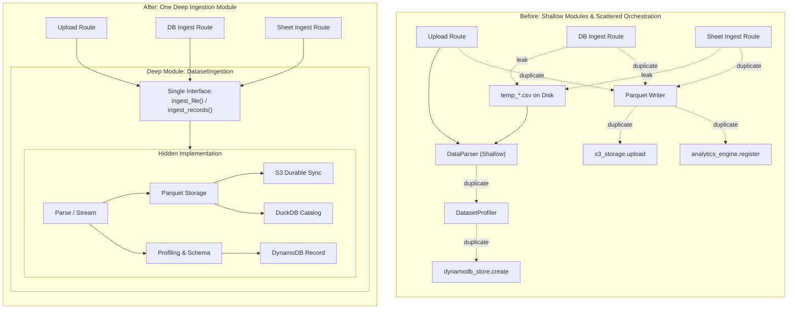
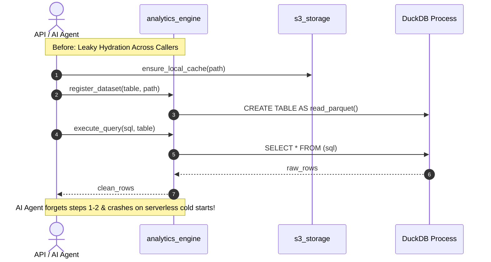
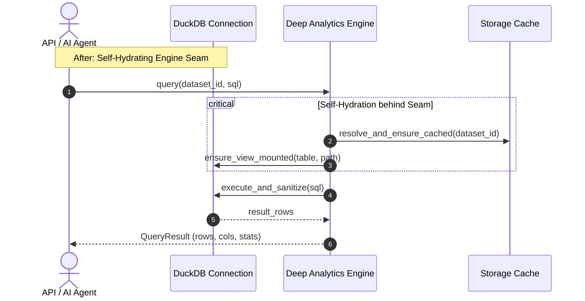
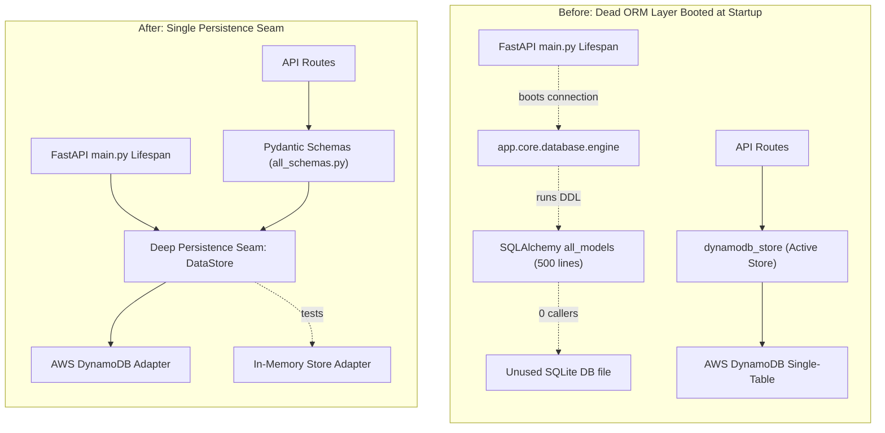
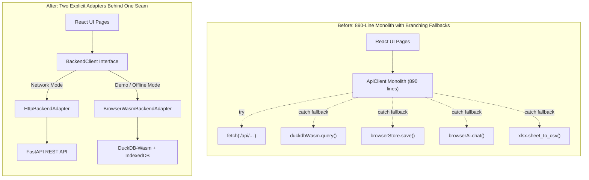

# Architecture Review: Autoanalytix

> **Date:** October 20, 2026  
> **Status:** Architecture Assessment & Deepening Opportunities  
> **Interactive Visual Report:** [`docs/ARCHITECTURE_REVIEW.html`](./ARCHITECTURE_REVIEW.html)

---

## Schematic Legend

- **Module**: A unit of code providing functionality through an interface.
- **Seam**: A place where code connects to other code, and where tests or alternate adapters can plug in.
- **Leakage**: Responsibilities or implementation details escaping across a seam into callers.
- **Deep Module**: An abstraction with a small, clear interface that hides significant internal complexity.

---

## Top Recommendation: Highest Immediate Leverage

### Candidate 1: Collapse the Dataset Ingestion Pipeline into a Deep Module

Three API controllers redundantly orchestrate temporary disk CSV serialization, Parquet writes, S3 syncs, and DuckDB table cataloging over 150 duplicate lines.

---

## Candidate 1: Collapse the Dataset Ingestion Pipeline

- **Recommendation Strength:** `Strong`
- **Category:** `in-process`
- **Files Involved:**
  - `backend/app/ingestion/parser.py`
  - `backend/app/analytics/profiler.py`
  - `backend/app/api/datasets.py`
  - `backend/app/api/data_sources.py`
  - `backend/app/api/integrations_google.py`

### Visual Architectural Comparison

- **Problem:** Three API controllers manually coordinate six shallow modules and temporary CSV disk serialization to ingest data.
- **Solution:** Consolidate parsing, profiling, Parquet persistence, and engine registration behind one deep `DatasetIngestion` module.
- **Wins:**
  - **Locality:** Ingestion bugs stay concentrated in one place
  - **Interface shrinks:** Three controllers delete 150 lines
  - **Leverage:** One interface for all sources
  - **Performance:** Eliminates disk CSV intermediate serialization

---

## Candidate 2: Deepen DuckDB Analytics Engine with Self-Hydrating Execution

- **Recommendation Strength:** `Strong`
- **Category:** `ports & adapters`
- **Files Involved:**
  - `backend/app/analytics/engine.py`
  - `backend/app/core/s3_storage.py`
  - `backend/app/api/datasets.py`
  - `backend/app/ai/agents/analytics_graph.py`
  - `backend/app/ai/agents/dashboard_graph.py`

### Visual Architectural Comparison

- **Problem:** The analytics engine requires callers to manually orchestrate S3 cache hydration and table registration before querying.
- **Solution:** Deepen the engine module to resolve and hydrate datasets automatically behind a single query interface.
- **Wins:**
  - **Locality:** Cache synchronization stays internal to the engine
  - **Reliability:** Prevents AI agent cold-start crashes completely
  - **Leverage:** One interface for all callers
  - **Testability:** Tests hit one in-memory seam

---

## Candidate 3: Delete Ghost SQLAlchemy Layer & Clarify Persistence Seam

- **Recommendation Strength:** `Strong`
- **Category:** `in-process`
- **Files Involved:**
  - `backend/app/core/database.py`
  - `backend/app/models/base.py`
  - `backend/app/models/all_models.py`
  - `backend/app/main.py`
  - `backend/app/core/dynamodb.py`

### Visual Architectural Comparison

- **Problem:** Five hundred lines of unused SQLAlchemy models and connection pooling boot on every startup despite migration to DynamoDB.
- **Solution:** Delete the dead SQLAlchemy module tree and establish DynamoDB as the unambiguous persistence implementation.
- **Wins:**
  - **Deletion test:** 500 dead lines deleted
  - **Startup speed:** Cold starts drop initialization latency
  - **Seam clarity:** Pydantic schemas define entities
  - **Locality:** Eliminates dual-model schema confusion

---

## Candidate 4: Extract Explicit Backend Adapters in Frontend Client

- **Recommendation Strength:** `Worth exploring`
- **Category:** `local-substitutable`
- **Files Involved:**
  - `frontend/src/services/api.ts`
  - `frontend/src/services/browserStore.ts`
  - `frontend/src/services/duckdbWasm.ts`
  - `frontend/src/services/browserAi.ts`

### Visual Architectural Comparison

- **Problem:** An 890-line client monolith interweaves network calls and browser-WASM fallbacks inside dozens of nested `try/catch` blocks.
- **Solution:** Introduce an explicit backend seam with separate HTTP and browser-WASM adapter implementations.
- **Wins:**
  - **Seam justified:** Two real adapters justify the abstraction
  - **Interface shrinks:** Client sheds fallback branching
  - **Locality:** Network logic separated from WASM
  - **Testability:** Mock adapter swaps without network mocks
